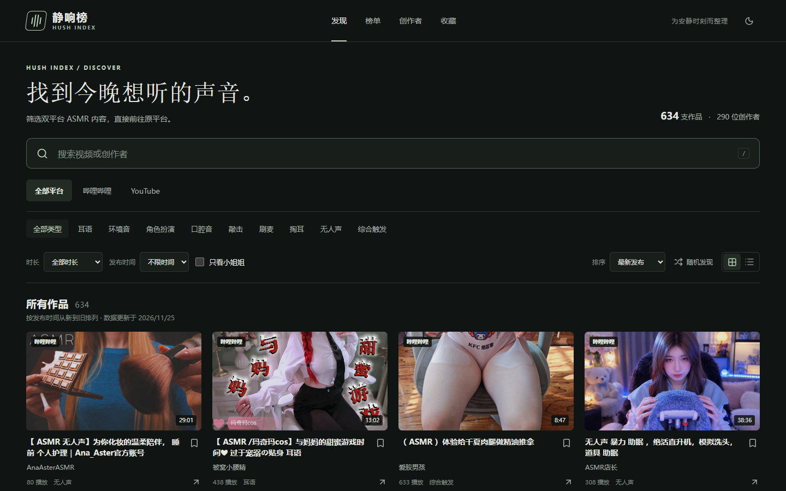
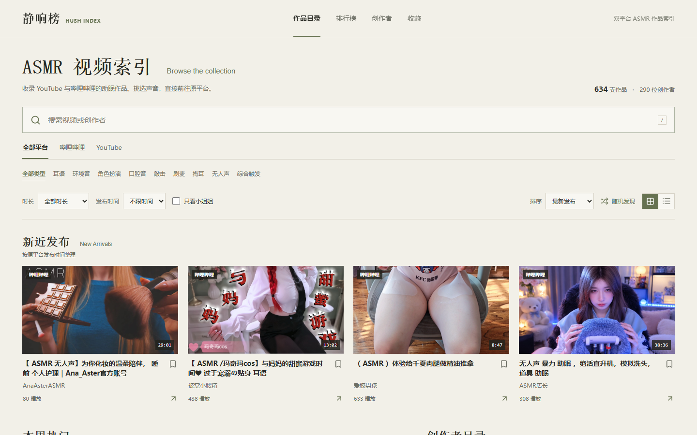
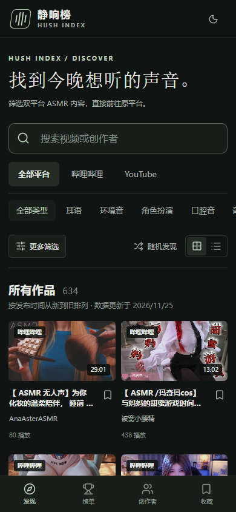
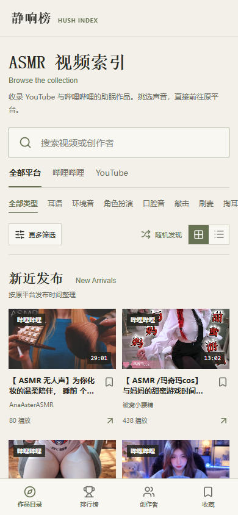

# Digital Independent Record Store 改版记录

这次视觉改版从 V2 功能分支出发，保留真实数据、采集清洗脚本、B站原榜单算法、本地收藏和 GitHub Pages 配置。

## 改版前审计

- 深色音频品牌视觉与新确定的数字独立唱片店定位不符。
- 首页虽能快速浏览作品，但缺少新到作品、近期作品榜与创作者的目录层次。
- 视频、榜单与创作者功能已经具备，可直接沿用；无须引入后端或设计虚构的唱片信息。

## 本次改动

- 整份重写 `src/styles.css`：暖纸色、炭黑字、橄榄绿、细分隔线与编辑出版物式层次。
- 首页改为「ASMR 视频索引 → 搜索与筛选 → 新近发布 → 本周热门 → 创作者目录 → 其余作品」。
- “新近发布”按**视频发布时间**；现有数据没有准确的逐条首次收录时间。
- “本周热门”仅取 B站近 7 天发布作品，按公开播放量排序；原算法榜保持原样。
- 封面保持 16:9，不添加虚构唱片编号、销量或评分。
- 去掉深色主题切换与额外品牌装饰，保留本地收藏、导入导出、外链、搜索、筛选和移动底部导航。

## 截图

| 改版前 | 改版后 |
|---|---|
|  |  |
|  |  |

英文界面验收：[桌面截图](english-desktop.png) · [手机截图](english-mobile.png)。导航、筛选、榜单、创作者、收藏、说明及独立隐私页均支持中英切换；原平台视频标题和创作者名称保留原文。

## 本地验收

- `npm test`：14 项通过。
- `npm run build`：TypeScript 与生产构建通过。
- Chrome 实测 360、390、430、768、1024、1440、1920px：均无横向溢出。
- 实测首页三个目录区、筛选 URL、收藏持久化、榜单、创作者链接与手机导航正常。
- 截图及测试均使用仓库真实 `public/data/rankings.json`。

本分支用于评审；不触发 main 分支的 GitHub Pages 部署。
